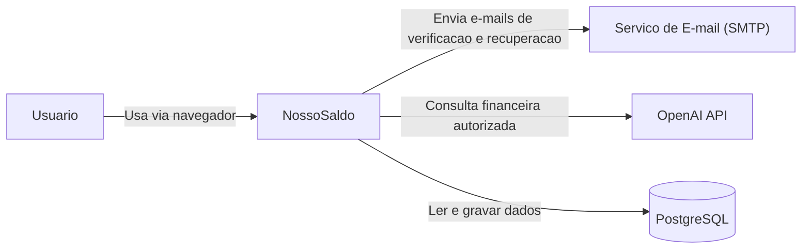
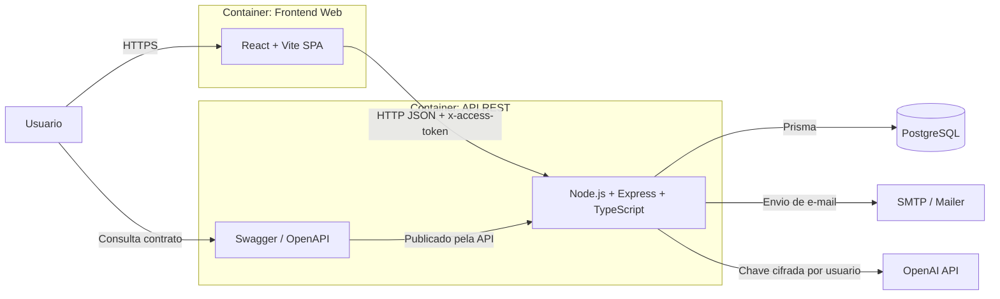
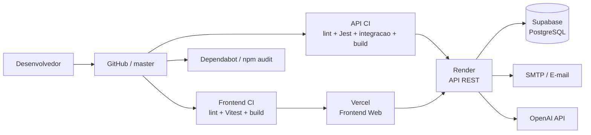
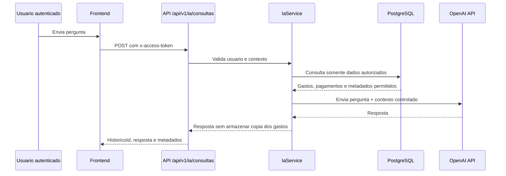
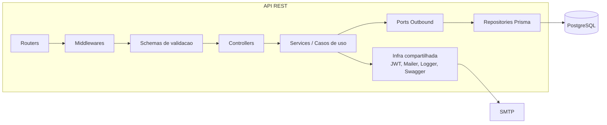
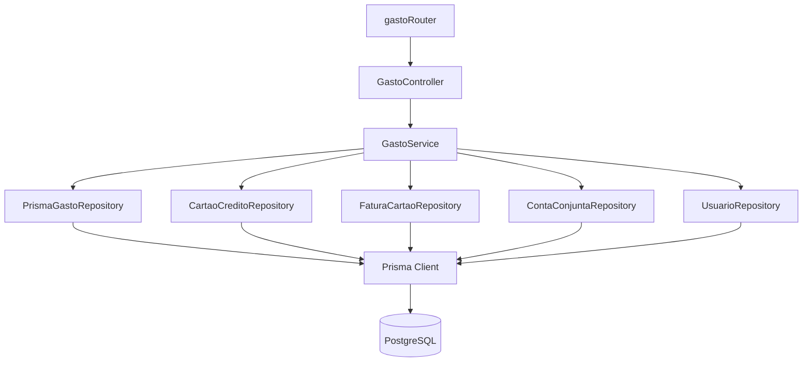

# Arquitetura C4 Model do NossoSaldo

## Objetivo

Este documento descreve a arquitetura do `NossoSaldo` usando o padrao `C4 Model`, com foco em facilitar entendimento tecnico para desenvolvedores e arquitetos.

O documento foi construido com base na estrutura real do projeto e complementa:

- [arquitetura-software.md](C:/Projetos/NossoSaldo/docs/arquitetura-software.md)
- [arquitetura.md](C:/Projetos/NossoSaldo/api/src/docs/arquitetura.md)
- [arquitetura-hexagonal.md](C:/Projetos/NossoSaldo/api/src/docs/arquitetura-hexagonal.md)

## Escopo e leitura

Este material esta organizado nos niveis:

- `Nivel 1 - System Context`
- `Nivel 2 - Container`
- `Nivel 3 - Component`
- `Nivel 4 - Code` em nivel introdutorio para o backend

Observacao:

- os diagramas e descricoes refletem o estado atual do codigo;
- quando houver inferencia arquitetural, ela sera tratada como interpretacao tecnica e nao como fato historico do projeto.

---

## Nivel 1 - System Context

### Visao

O `NossoSaldo` e um sistema para controle financeiro compartilhado, com foco principal em permitir que casais registrem e acompanhem gastos conjuntos em um local unico.

### Atores e sistemas externos

- `Usuario`: pessoa que acessa a plataforma para registrar, consultar e acompanhar gastos.
- `SMTP / provedor de e-mail`: servico externo usado para recuperacao de senha e validacao de e-mail.
- `OpenAI API`: provedor externo opcional usado pelo assistente financeiro com a chave configurada pelo usuario.
- `Banco PostgreSQL`: persistencia principal da aplicacao.

### Diagrama de contexto



### Responsabilidade do sistema

O sistema e responsavel por:

- autenticacao de usuarios;
- cadastro e manutencao de categorias;
- gestao de gastos unicos, recorrentes e parcelados;
- controle de cartoes de credito e faturas;
- compartilhamento de informacoes entre usuarios vinculados em conta conjunta;
- emissao de relatorios e insights operacionais;
- consultas financeiras controladas pelo assistente, restritas aos dados autorizados do usuario.

---

## Nivel 2 - Container

### Containers identificados

No estado atual, os principais containers do sistema sao:

1. `Frontend Web`
2. `API REST`
3. `Banco de Dados PostgreSQL`
4. `Servico de E-mail`
5. `OpenAI API`

### Diagrama de containers



### Descricao dos containers

#### 1. Frontend Web

Tecnologias:

- `React`
- `Vite`
- `JavaScript`

Responsabilidades:

- interface do usuario;
- navegacao da SPA;
- formularios e dashboards;
- filtros e apresentacao de relatorios;
- consumo da API versionada em `/api/v1`.

Arquivos principais:

- [frontend/src/App.jsx](C:/Projetos/NossoSaldo/frontend/src/App.jsx)
- [frontend/src/services/api.js](C:/Projetos/NossoSaldo/frontend/src/services/api.js)

#### 2. API REST

Tecnologias:

- `Node.js`
- `Express`
- `TypeScript`
- `Prisma`

Responsabilidades:

- autenticacao e autorizacao;
- execucao das regras de negocio;
- persistencia de dados;
- exposicao do contrato REST;
- publicacao do Swagger;
- integracao com e-mail.

Arquivos principais:

- [api/src/app.ts](C:/Projetos/NossoSaldo/api/src/app.ts)
- [api/src/routers/mainrouter.ts](C:/Projetos/NossoSaldo/api/src/routers/mainrouter.ts)
- [api/src/config/apiVersion.ts](C:/Projetos/NossoSaldo/api/src/config/apiVersion.ts)

#### 3. Banco de Dados PostgreSQL

Tecnologia:

- `PostgreSQL`

Responsabilidades:

- armazenar usuarios, gastos, parcelas, faturas, categorias, contas conjuntas e tokens.

Referencia:

- [api/prisma/schema.prisma](C:/Projetos/NossoSaldo/api/prisma/schema.prisma)

#### 4. Servico de E-mail

Responsabilidade:

- envio de e-mail de validacao de conta;
- envio de e-mail de recuperacao de senha.

Referencia:

- [api/src/lib/mailer.ts](C:/Projetos/NossoSaldo/api/src/lib/mailer.ts)

#### 5. OpenAI API

Responsabilidade:

- responder consultas financeiras controladas pelo backend;
- receber somente o contexto financeiro permitido para o usuario autenticado;
- usar a chave do proprio usuario, cifrada no backend e nunca exposta ao frontend.

Referencias:

- [api/src/services/ia/iaService.ts](C:/Projetos/NossoSaldo/api/src/services/ia/iaService.ts)
- [api/src/adapters/outbound/openai/openAiProvider.ts](C:/Projetos/NossoSaldo/api/src/adapters/outbound/openai/openAiProvider.ts)

---

## Topologia de execucao e entrega

O codigo e mantido em dois repositorios, ambos com validacao automatica na branch `master`.



Observacoes:

- CI verde significa que lint, testes e build passaram; o deploy e executado pelos provedores Render e Vercel.
- O ambiente publicado usa PostgreSQL no Supabase.
- O workflow de smoke test da API verifica disponibilidade apos o deploy quando configurado.
- Dependabot cria PRs de dependencias, mas nenhuma atualizacao deve ser incorporada sem CI verde.

---

## Assistente financeiro e limites de dados



A configuracao do provedor e uma preferencia por usuario. A chave nao deve ser enviada para o navegador, e o backend deve impedir consultas fora do contexto financeiro do NossoSaldo.

---

## Nivel 3 - Component

### Container detalhado: API REST

O container mais relevante para detalhamento arquitetural e a API.

### Componentes principais da API

1. `Routers`
2. `Middlewares`
3. `Schemas`
4. `Controllers`
5. `Services`
6. `Ports / Contracts`
7. `Repositories`
8. `Infraestrutura compartilhada`

### Diagrama de componentes da API



### Descricao dos componentes

#### Routers

Responsabilidade:

- expor endpoints REST;
- aplicar middlewares;
- encaminhar requisicoes para controllers.

Exemplos:

- [api/src/routers/usuario/usuarioRouter.ts](C:/Projetos/NossoSaldo/api/src/routers/usuario/usuarioRouter.ts)
- [api/src/routers/gasto/gastoRouter.ts](C:/Projetos/NossoSaldo/api/src/routers/gasto/gastoRouter.ts)
- [api/src/routers/relatorio/relatorioRouter.ts](C:/Projetos/NossoSaldo/api/src/routers/relatorio/relatorioRouter.ts)

#### Middlewares

Responsabilidade:

- validacao de token;
- validacao de payload;
- validacao de parametros;
- tratamento transversal de entrada.

Exemplos:

- [api/src/routers/middlewares/loginMiddleware.ts](C:/Projetos/NossoSaldo/api/src/routers/middlewares/loginMiddleware.ts)
- [api/src/routers/middlewares/usuarioMiddleware.ts](C:/Projetos/NossoSaldo/api/src/routers/middlewares/usuarioMiddleware.ts)

#### Schemas

Responsabilidade:

- validar contratos de entrada antes da execucao da regra de negocio.

Exemplos:

- [api/src/schemas/gasto/createGastoSchema.ts](C:/Projetos/NossoSaldo/api/src/schemas/gasto/createGastoSchema.ts)
- [api/src/schemas/usuario/createUsuarioSchema.ts](C:/Projetos/NossoSaldo/api/src/schemas/usuario/createUsuarioSchema.ts)

#### Controllers

Responsabilidade:

- traduzir a requisicao HTTP para chamadas de aplicacao;
- devolver respostas padronizadas com `sendSuccess`;
- interpretar contexto de autenticacao e parametros.

Exemplos:

- [api/src/controllers/gasto/gastoController.ts](C:/Projetos/NossoSaldo/api/src/controllers/gasto/gastoController.ts)
- [api/src/controllers/usuario/usuarioController.ts](C:/Projetos/NossoSaldo/api/src/controllers/usuario/usuarioController.ts)

#### Services

Responsabilidade:

- concentrar os fluxos de negocio;
- aplicar validacoes funcionais;
- coordenar repositores e componentes tecnicos.

Exemplos:

- [api/src/services/gasto/gastoService.ts](C:/Projetos/NossoSaldo/api/src/services/gasto/gastoService.ts)
- [api/src/services/usuario/usuarioService.ts](C:/Projetos/NossoSaldo/api/src/services/usuario/usuarioService.ts)
- [api/src/services/relatorio/relatorioService.ts](C:/Projetos/NossoSaldo/api/src/services/relatorio/relatorioService.ts)

#### Ports Outbound

Responsabilidade:

- definir contratos para acesso a persistencia e outras dependencias externas.

Exemplos:

- [api/src/ports/outbound/gastoRepositoryPort.ts](C:/Projetos/NossoSaldo/api/src/ports/outbound/gastoRepositoryPort.ts)
- [api/src/ports/outbound/usuarioRepositoryPort.ts](C:/Projetos/NossoSaldo/api/src/ports/outbound/usuarioRepositoryPort.ts)

#### Repositories

Responsabilidade:

- implementar acesso ao banco;
- encapsular queries Prisma;
- lidar com transacoes e mapeamento de erro tecnico.

Exemplos:

- [api/src/repositories/gasto/gastoRepository.ts](C:/Projetos/NossoSaldo/api/src/repositories/gasto/gastoRepository.ts)
- [api/src/repositories/usuario/usuarioRepository.ts](C:/Projetos/NossoSaldo/api/src/repositories/usuario/usuarioRepository.ts)

#### Infraestrutura compartilhada

Responsabilidade:

- seguranca;
- logger;
- prisma;
- mailer;
- documentacao.

Exemplos:

- [api/src/lib/prisma.ts](C:/Projetos/NossoSaldo/api/src/lib/prisma.ts)
- [api/src/lib/logger.ts](C:/Projetos/NossoSaldo/api/src/lib/logger.ts)
- [api/src/lib/mailer.ts](C:/Projetos/NossoSaldo/api/src/lib/mailer.ts)
- [api/src/docs/openapi.ts](C:/Projetos/NossoSaldo/api/src/docs/openapi.ts)

---

## Nivel 4 - Code

### Foco: modulo de gastos

O modulo de gastos e um dos melhores candidatos para visualizar o codigo no nivel C4, porque concentra boa parte da complexidade funcional do sistema.

### Estrutura interna do modulo

```text
gastoRouter
  -> gastoController
    -> gastoService
      -> gastoRepository
      -> cartaoCreditoRepository
      -> faturaCartaoRepository
      -> contaConjuntaRepository
      -> usuarioRepository
```

### Diagrama de codigo simplificado do modulo de gastos



### Responsabilidades tecnicas observadas

#### `GastoController`

- recebe o contexto HTTP;
- extrai `payload.id` do usuario autenticado;
- traduz corpo, query e path params;
- delega ao service.

Referencia:

- [api/src/controllers/gasto/gastoController.ts](C:/Projetos/NossoSaldo/api/src/controllers/gasto/gastoController.ts)

#### `GastoService`

- orquestra regras de negocio complexas;
- calcula competencia e recorrencia;
- sincroniza series recorrentes;
- valida permissao sobre cartoes;
- integra parcelas e faturas;
- aplica regras de pagamento, reabertura e exclusao.

Referencia:

- [api/src/services/gasto/gastoService.ts](C:/Projetos/NossoSaldo/api/src/services/gasto/gastoService.ts)

#### `PrismaGastoRepository`

- cria gastos;
- gera parcelas em `LancamentoBase`;
- atualiza gastos;
- trata soft delete;
- executa transacoes no contexto Prisma.

Referencia:

- [api/src/repositories/gasto/gastoRepository.ts](C:/Projetos/NossoSaldo/api/src/repositories/gasto/gastoRepository.ts)

### Leitura arquitetural do nivel 4

Este modulo mostra com clareza que:

- a aplicacao esta bem separada em termos de entrada HTTP, regra e persistencia;
- a complexidade funcional esta concentrada em `GastoService`;
- o modulo ainda nao esta separado em `domain entities`, `domain services` e `application use cases`.

Ou seja:

- no nivel C4, o desenho esta claro;
- no nivel de design interno, ainda ha espaco para evoluir do service central para um nucleo de dominio mais explicito.

---

## Mapeamento do C4 para a arquitetura hexagonal atual

### Correspondencia pratica

| C4 | NossoSaldo |
| --- | --- |
| System Context | Usuario, NossoSaldo, SMTP, PostgreSQL |
| Container | Frontend, API, Banco, Servico de e-mail |
| Component | Routers, Controllers, Services, Ports, Repositories, Infra |
| Code | Modulos internos como `gasto`, `usuario`, `faturaCartao` |

### Leitura tecnica

O C4 ajuda a comunicar:

- como o sistema se divide estruturalmente;
- onde cada responsabilidade esta;
- como o backend se aproxima de hexagonal.

A arquitetura hexagonal ajuda a explicar:

- por que existem `ports` e `adapters`;
- como o backend busca isolar a regra de negocio dos detalhes tecnicos.

Esses dois modelos se complementam bem no contexto do `NossoSaldo`.

---

## Riscos arquiteturais observados sob a otica do C4

- O `Container Frontend` esta excessivamente concentrado em um arquivo principal.
- O `Container API` tem boa organizacao, mas alguns `Components` de service concentram muita responsabilidade.
- O `Nivel 4` mostra dependencia relevante entre regras de gasto, parcelas e faturas, o que eleva o risco de regressao.
- A camada de dominio ainda nao esta explicitamente separada no mapa de componentes.

---

## Recomendacoes para evolucao do C4 do projeto

### Curto prazo

- manter este documento como mapa oficial da arquitetura;
- atualizar o C4 sempre que houver mudanca em contrato, persistencia ou modulo principal;
- usar este material junto com a documentacao de arquitetura existente.

### Medio prazo

- detalhar tambem o `Container Frontend` no nivel de componentes;
- criar uma visao especifica do modulo de relatorios;
- adicionar um diagrama C4 voltado a seguranca e autenticacao.

### Longo prazo

- formalizar melhor `domain`, `application`, `adapters` e `infrastructure`;
- transformar parte do `Nivel 4` em ADRs e diagramas por contexto de negocio;
- usar o C4 como base de governanca arquitetural e revisao tecnica continua.

---

## Conclusao

Sim, o material arquitetural atual do projeto e suficiente para manter uma documentacao no padrao `C4 Model`.

No estado atual, o `NossoSaldo` ja tem elementos suficientes para representar com clareza:

- o contexto do sistema;
- os containers principais;
- os componentes relevantes do backend;
- a estrutura interna de modulos criticos como `gasto`.

O proximo passo ideal e evoluir este documento junto com:

- modularizacao do frontend;
- amadurecimento da arquitetura hexagonal;
- correcoes de vulnerabilidades e endurecimento tecnico do sistema.
