# Arquitetura Visual do NossoSaldo

## Objetivo

Este documento apresenta a arquitetura do `NossoSaldo` em formato visual, usando `Markdown + Mermaid`, para facilitar leitura tecnica, onboarding e evolucao arquitetural do projeto.

Ele complementa:

- [arquitetura-software.md](C:/Projetos/NossoSaldo/docs/arquitetura-software.md)
- [arquitetura-c4-model.md](C:/Projetos/NossoSaldo/docs/arquitetura-c4-model.md)

---

## 1. Visao Geral

O `NossoSaldo` e uma plataforma web para gestao de gastos compartilhados, com frontend separado da API REST, persistencia em `PostgreSQL` e contratos versionados em `/api/v1`.

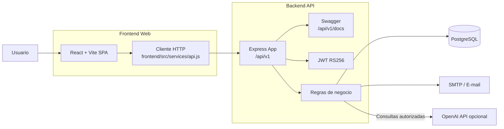

---

## 2. Contexto do Sistema

Este diagrama mostra o sistema no contexto de uso.

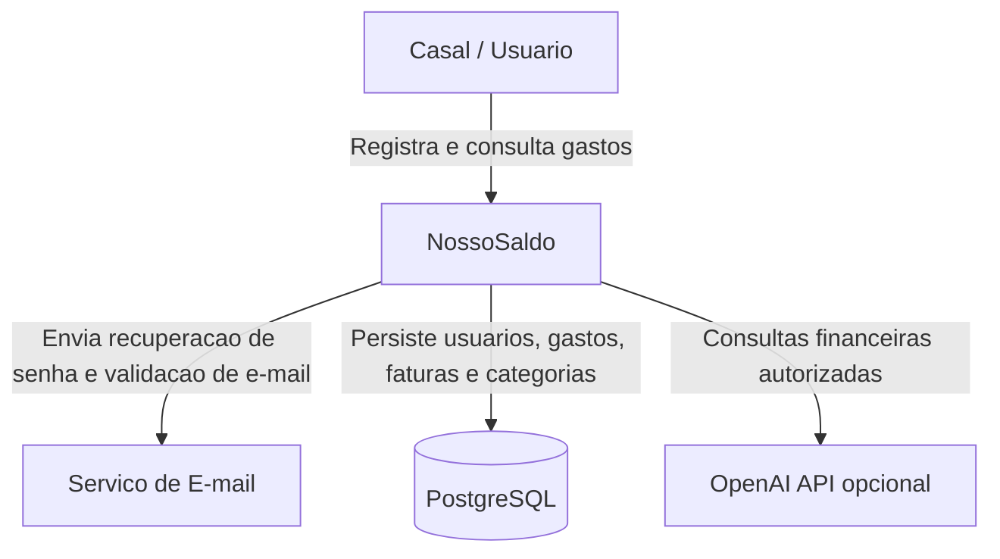

---

## 3. Containers

O sistema esta dividido em cinco containers principais, considerando a integracao externa opcional com a OpenAI.

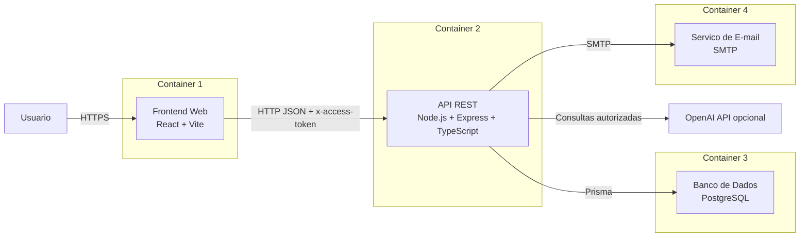

### Resumo dos containers

- `Frontend Web`: interface, navegacao, filtros, dashboards e formularios.
- `API REST`: autenticacao, regras de negocio, persistencia e documentacao.
- `PostgreSQL`: armazenamento principal.
- `SMTP`: comunicacao por e-mail.
- `OpenAI API`: provedor opcional do assistente financeiro, acionado pelo backend com a configuracao do usuario.

---

## 4. Backend em Camadas

O backend segue um fluxo em camadas com inclinacao para arquitetura hexagonal.

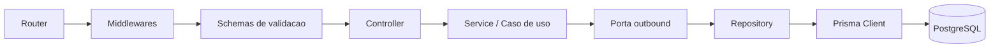

### Leitura do fluxo

- `Router`: expõe a rota.
- `Middleware`: valida token, params ou payload.
- `Schema`: garante contrato de entrada.
- `Controller`: adapta HTTP para aplicação.
- `Service`: executa regra de negocio.
- `Port`: define contrato de saida.
- `Repository`: implementa acesso concreto ao banco.

---

## 5. Visao Hexagonal

O backend ja apresenta elementos fortes de `Ports and Adapters`.

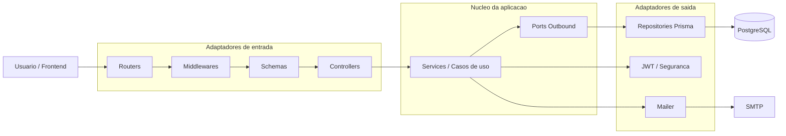

### Diagnostico visual

- A arquitetura ja se aproxima de hexagonal no backend.
- O dominio ainda nao esta separado como camada propria.
- Os `services` ainda concentram boa parte da orquestracao.

---

## 6. Modulos Principais da API

Os principais modulos de negocio do backend hoje sao:

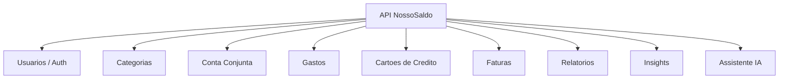

### Papel de cada modulo

- `Usuarios / Auth`: login, cadastro, senha, validacao de e-mail.
- `Categorias`: agrupamento semantico dos lancamentos.
- `Conta Conjunta`: compartilhamento entre usuarios.
- `Gastos`: modulo central do dominio financeiro.
- `Cartoes`: cadastro e administracao de cartoes.
- `Faturas`: consolidacao de gastos de cartao.
- `Relatorios`: visoes analiticas.
- `Insights`: analise orientada a gargalos.
- `Assistente IA`: consultas financeiras controladas por funcoes, usando a chave configurada pelo usuario.

---

## 7. Entrega, testes e operacao

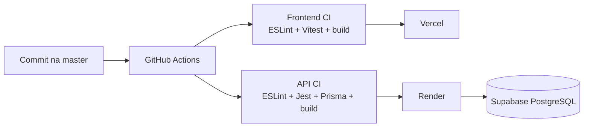

O pipeline atual possui 7 testes no frontend, 323 testes unitarios na API e 2 cenarios integrados contra PostgreSQL efemero. Os checks verdes indicam validação técnica; a publicação efetiva ocorre nos serviços Vercel e Render conectados à `master`.

---

## 8. Fluxo de Autenticacao

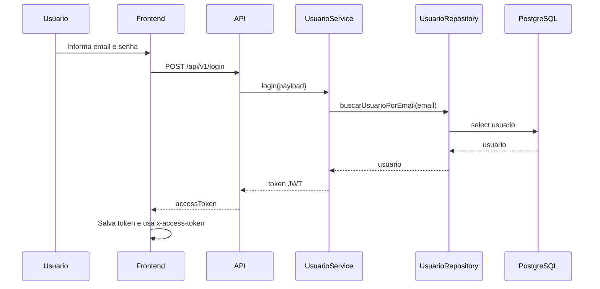

---

## 9. Fluxo de Cadastro de Gasto

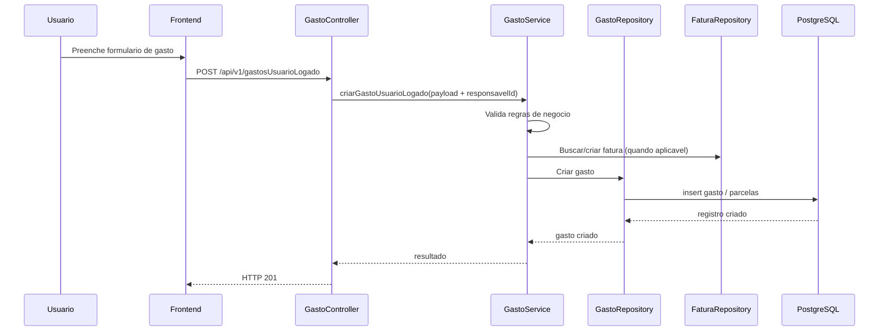

### Regras relevantes do fluxo

- gasto pode ser `unico`, `recorrente` ou `parcelado`;
- pode estar vinculado a cartao;
- pode gerar parcelas em `LancamentoBase`;
- pode gerar ou recalcular faturas.

---

## 10. Fluxo de Conta Conjunta e Compartilhamento

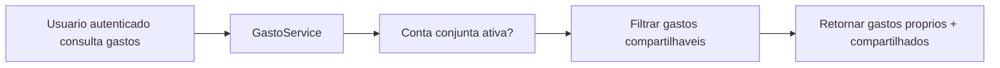

### Comportamento observado

- o usuario sempre enxerga seus proprios gastos;
- gastos do parceiro aparecem quando ha conta conjunta ativa;
- o campo `naoCompartilhar` restringe visualizacao.

---

## 11. Modelo de Dados Principal

Este diagrama resume as entidades mais relevantes para o dominio.

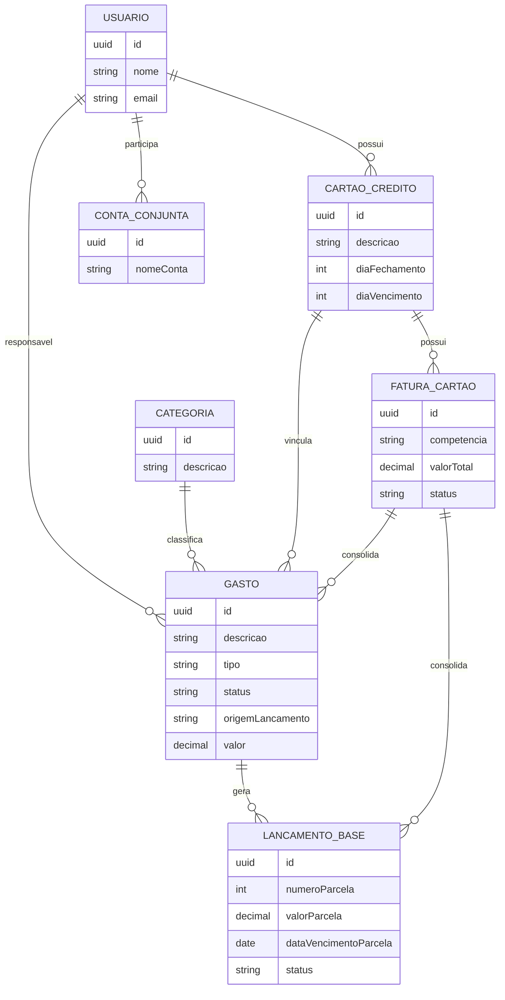

---

## 12. Versionamento da API

O projeto ja possui versionamento explicito da API.

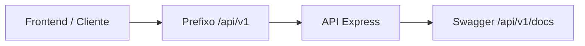

### Implicacao arquitetural

- o contrato externo esta versionado;
- a implementacao interna dos routers permanece desacoplada do prefixo;
- isso facilita futura coexistencia de `v1` e `v2`.

---

## 13. Pontos Fortes

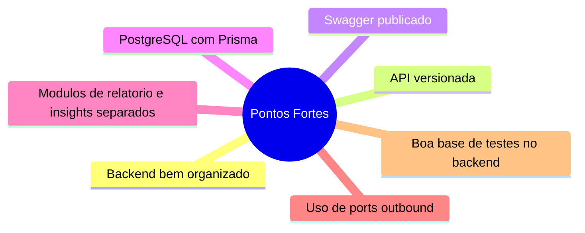

---

## 14. Pontos de Atencao

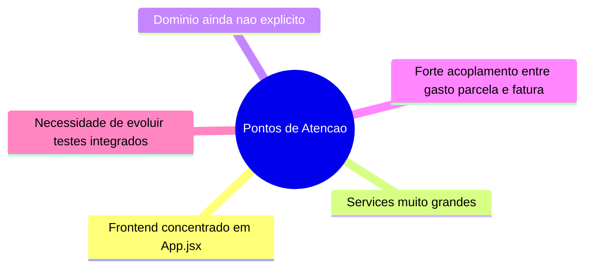

---

## 15. Roadmap Arquitetural Sugerido

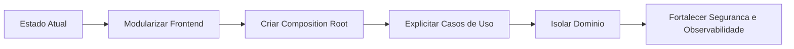

### Prioridades recomendadas

- `Alta`: modularizacao do frontend.
- `Alta`: endurecimento arquitetural do backend.
- `Media`: testes e2e e observabilidade.
- `Media`: evolucao da documentacao e governanca arquitetural.

---

## 16. Conclusao

O `NossoSaldo` ja possui uma arquitetura suficientemente estruturada para documentacao visual eficaz. O backend esta em um bom caminho para consolidar uma arquitetura hexagonal pragmatica, enquanto o frontend ainda precisa amadurecer em modularidade.

Este documento deve ser tratado como artefato vivo e atualizado conforme avancarmos em:

- modularizacao;
- mitigacao de vulnerabilidades;
- evolucao de contratos;
- amadurecimento da arquitetura.
